# The Champagne Spy, Restored Pixel by Pixel

A restoration of an interlaced PAL DVD in which every half-picture was judged on its own evidence and every pixel of the result is accounted for: kept, lifted, calculated or rebuilt. Every decision was measured, and every alternative that was built and discarded is recorded.

**The source.** *The Champagne Spy* (2007), a documentary by Nadav Schirman, survives only on a German DVD from 2009 made for tube televisions: 25 interlaced frames per second, a German dub that drifts 83 ms out of sync, and German titles burned into the picture that the English subtitles never translated.

**The method.** Rather than run one deinterlacer over the whole film, each of the film's 271,174 half-pictures (fields) was compared with its three possible partners and judged on its own evidence. Where a partner captured at the same instant exists on the disc, the two were joined exactly: no calculation. Only where the disc holds no picture at all was anything computed.

*Available for consulting on restoration and AI-assisted engineering work; details at the end of this page.*

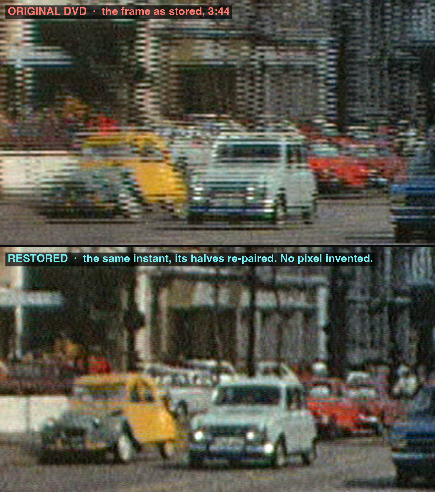

*The Paris street at 3:44, zoomed in. Top: the frame as the DVD stores it, with the halves of two different film frames interleaved, so every car and every tree is doubled. Bottom: the same instant with its halves re-paired from the neighbouring disc frame. Every line in the bottom picture is a line the disc holds, moved back to the frame it belongs to; none was invented.*

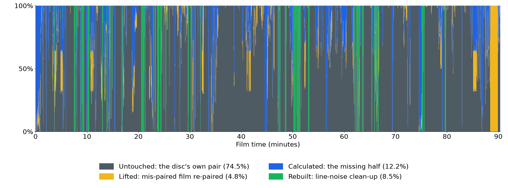

| | |
|---|---|
| Output frames kept pixel-exact from the disc | **79.2%** (74.5% joined with their own partner; 4.8% re-paired with the neighbouring frame's partner, which repairs mis-paired archive film by moving pixels, not inventing them) |
| Frames rebuilt only where the other half was never recorded | **12.2%** (motion-compensated deinterlacing, disc lines kept bit-exact) |
| Whole shots cleaned of transfer line noise | **8.5%** (116 of 908 shots, chosen by measurement and side-by-side review) |
| Output pixels that are the disc's own | **85.4%** of 112.5 billion; 88.4% bit-identical |
| Finished film vs restored master, all 271,174 frames | **VMAF 96.08** mean, worst 1% 91.10; PSNR-Y 46.2 dB mean |
| German dub sync, worst case | **0.66 ms** (was 83 ms), one uniform speed correction of 22.16 ppm |
| Size | 7.41 GB for the set vs 7.92 GB disc image, with twice the frames, 10-bit colour and a lossless dub |
| Compute | one laptop: about 6.5 h of analysis, 8 h of unattended encoding, 48 min of automatic verification |

## Inside the frames: every pixel accounted for

The barcode above colours every output frame by how it was made. The figures below show the same four colours *inside* the frames. Left: the disc frame as stored. Middle: every line of the finished frame coloured by where it came from. Right: the finished frame. The top row is the full frame, the bottom row a 4.5× zoom on the spot marked in red, where the lines are wide enough to see one by one. Each figure also counts its pixels.

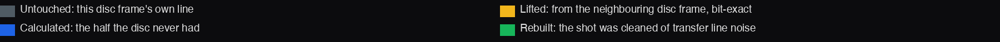

*The key, repeated in every figure below. Lifted means the disc had stored this instant's two halves in different frames and the missing half was moved back; calculated means the disc never recorded the other half of this instant; rebuilt means the shot is one of the 116 cleaned of transfer line noise.*

Each output frame receives exactly one treatment, so a single frame shows at most two colours: one for its own lines and one for what was done to the rest. The processes alternate from one frame to the next, which is what the barcode shows across the film and what the strip below shows inside one shot.

Over the whole film the result holds 112.5 billion pixels: 93.3 billion are the disc's own, untouched (83.0%); 2.7 billion are the disc's own, lifted into the frame they belong to (2.4%); 6.9 billion were calculated (6.1%); 9.6 billion were rebuilt (8.5%). That is 16.5 billion altered pixels, every one of them in a frame or a shot where the disc had no correct picture to keep. (The report's pixel chart, `figures/pixel.png`, splits the rebuilt shots differently: the half those shots never had counts there as calculated, 11.7 billion in all, and the half that was the disc's own, reworked by the clean-up, as 4.8 billion. The total altered is the same.)

The finished frames were rendered through the same pipeline that fed the encoder, and every line's origin was checked against the disc as the figures were made: the counts in each legend are bit-exact comparisons (`scripts/provenance_gallery.py`).

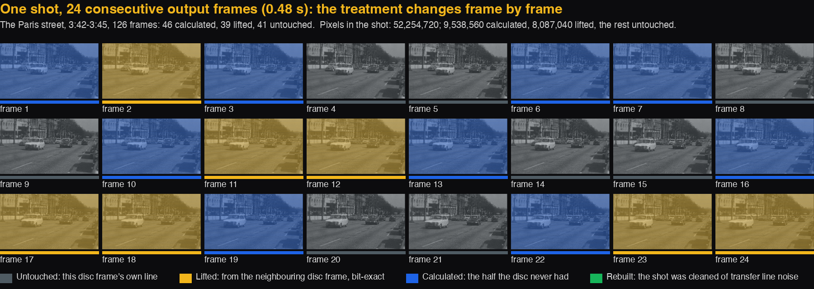

*One shot, the Paris street, 24 consecutive output frames (0.48 s). The treatment changes frame by frame with the film's 24-to-25 cadence. Over the shot's 126 frames: 46 calculated, 39 lifted, 41 untouched; of its 52.3 million pixels, 9.5 million were calculated and 8.1 million lifted into place.*

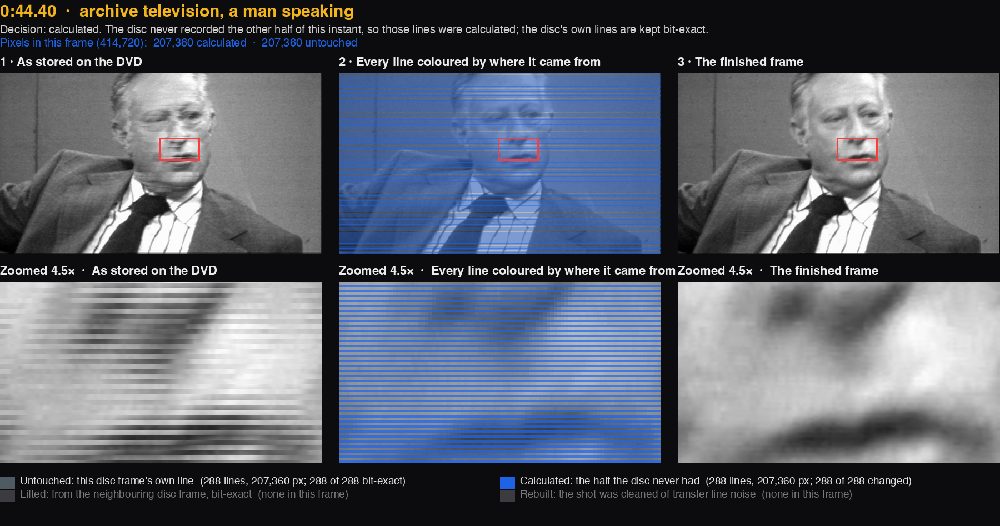

*0:44, archive television, a man speaking. The disc's own lines are kept bit-exact; the half the camera never recorded at this instant is calculated: 207,360 pixels. In the zoom, the mouth as stored is two moments interleaved; the finished frame is one.*

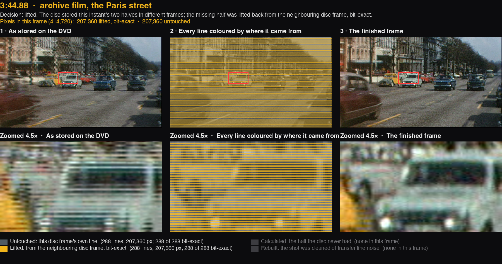

*3:44, archive film, the Paris street. The disc stored this instant's two halves in different frames; the missing half is lifted back from the neighbouring disc frame, 288 lines, bit-exact. Every car is doubled as stored and whole when finished.*

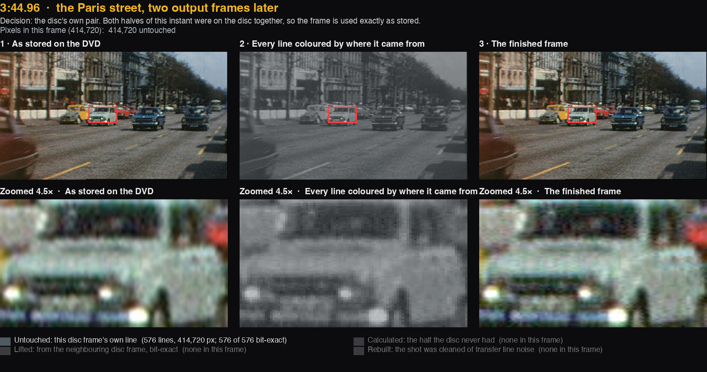

*3:44, the same street two output frames later. Both halves of this instant were stored together, so the frame is used exactly as it is on the disc: 576 of 576 lines untouched. Most of the film (74.5% of frames) is this case.*

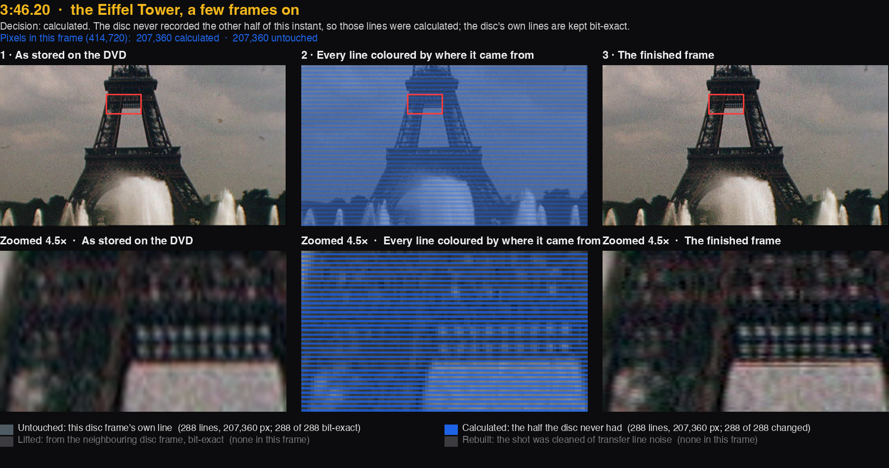

*3:46, the Eiffel Tower, a few frames on. This instant's other half is not on the disc at all, so its lines are calculated; the disc's own lines, ironwork included, are kept bit-exact. Three treatments inside one scene, chosen frame by frame.*

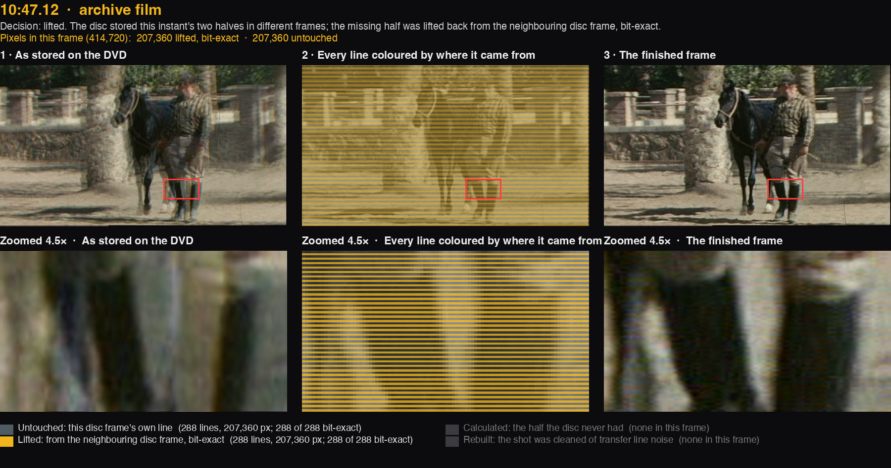

*10:47, archive film, a man leading a horse. Mis-paired film again: the legs are doubled as stored; the missing half is lifted back, bit-exact, and nothing is invented.*

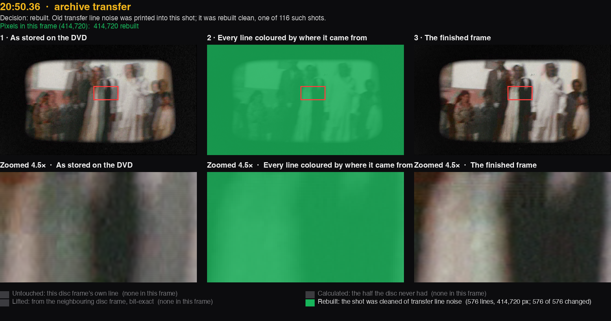

*20:50, archive television with its tube-screen mask, a group of people. Transfer line noise over the whole picture; all 414,720 pixels rebuilt.*

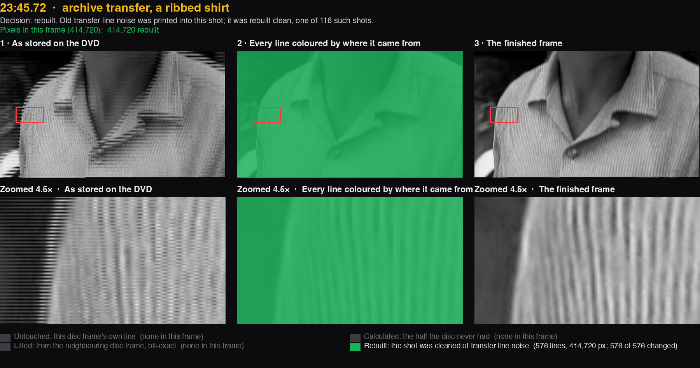

*23:45, archive transfer, a ribbed shirt. An old film-to-video transfer printed its line noise into the picture, so no line on the disc is right. One of the 116 shots rebuilt clean.*

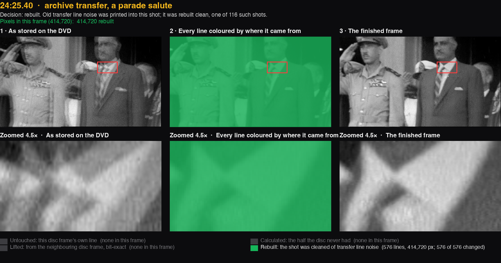

*24:25, archive transfer, a parade salute. The stripes across the tie and the uniform as stored are gone when finished.*

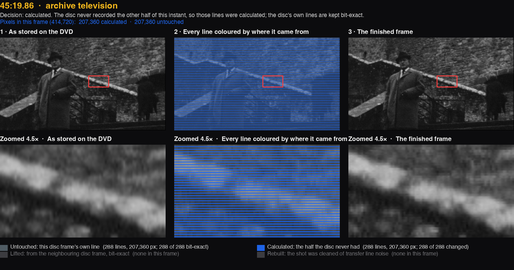

*45:19, archive television, a man in a hat by a stone wall. This shot uses the disc's other field order (bottom field first); the rule is the same, and the check against the disc passes the same way.*

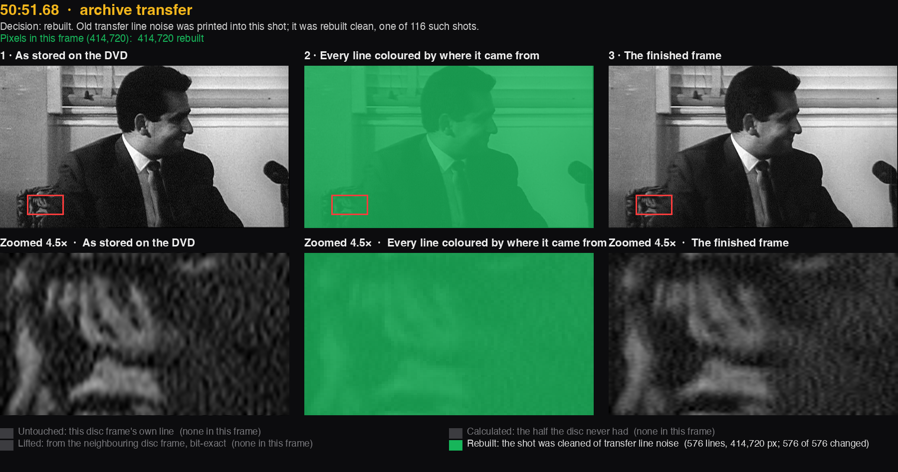

*50:51, archive transfer, a man in a suit. Line noise through the face and the chair; rebuilt clean.*

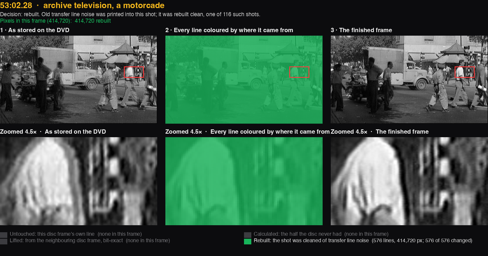

*53:02, archive television, a motorcade. Transfer line noise again, this time on moving figures.*

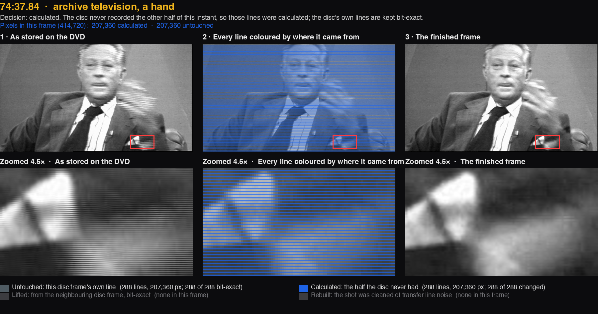

*74:37, archive television, a hand. True interlaced video: the two halves are 20 ms apart and the disc has no picture of the other half at this instant. The missing lines are calculated; the disc's lines stay.*

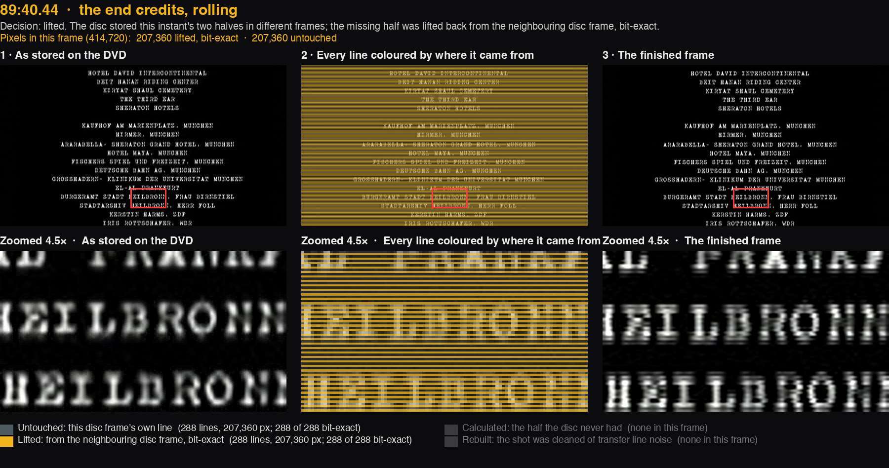

*89:40, the end credits, rolling. The credits roll on film stored with mismatched halves, so every letter is doubled as stored. The other half is lifted from the neighbouring disc frame, bit-exact, and the text is whole again.*

## What interlacing does, and what the restoration does about it

Every frame on a PAL DVD is two half-pictures, captured 20 ms apart and woven together line by line. A tube television drew them one after the other; a modern screen shows both at once, so anything that moved tears into stripes.

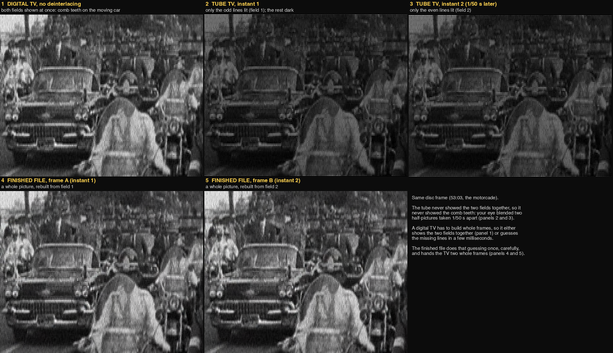

*One disc frame of the motorcade at 53:03. Panel 1: both halves shown together, as a computer or flat-screen player does without deinterlacing. Panels 2 and 3: what a tube television actually lit at each of the two instants. Panels 4 and 5: the two whole frames in the restored file.*

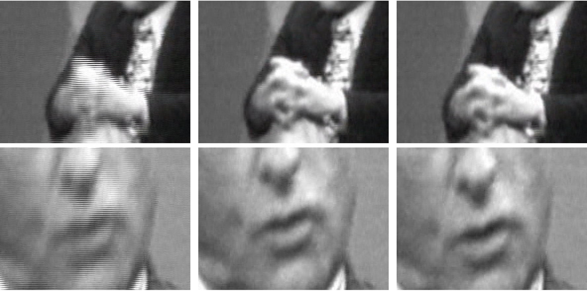

*Archive television (a hand at 74:34, a speaking mouth at 0:44). Left: the DVD frame, two moments woven together. Middle and right: the two clean 50 fps frames that were inside it, 20 ms apart. The missing lines of each were calculated; the lines the disc had are kept bit-exact.*

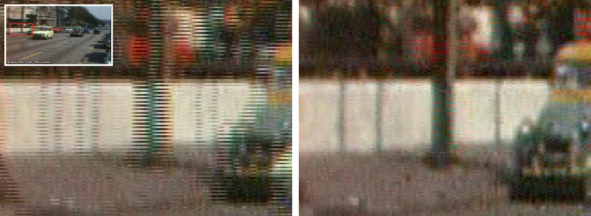

*Archive film, the Paris street at 3:43, the fence zoomed. Left: as the DVD stores it, the halves of two different film frames interleaved. Right: the same halves re-paired with their true partners from the neighbouring disc frame. No pixel was invented; this repair is the 4.8% of frames the barcode above marks as lifted.*

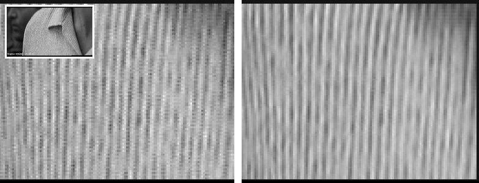

*A ribbed shirt at 23:46 that an old film-to-video transfer turned into a moiré. Left: the DVD's exact lines. Right: the clean rebuild, applied to the 116 shots where measurement and a side-by-side check agreed it helped.*

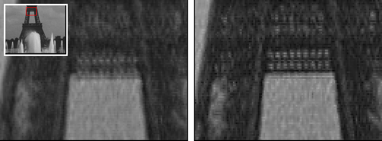

*Why the deinterlacer's defaults were not trusted. Left: its standard "lossless" mode, which reworks every line and blurs the Eiffel Tower's ironwork. Right: the mode used here, which keeps the disc's lines and fills in only the missing ones.*

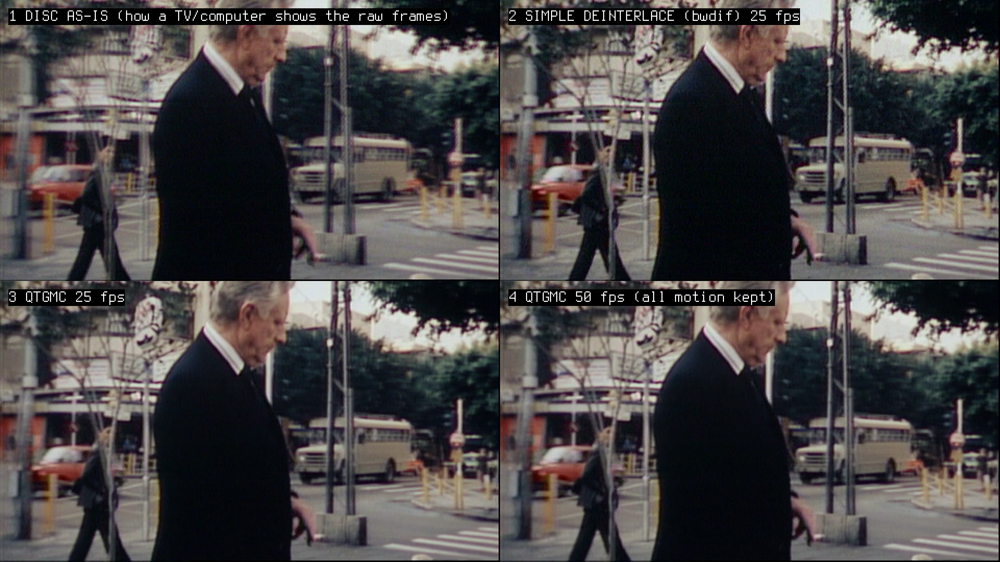

*The choice that set the frame rate. 1: the disc as stored, comb teeth on everything that moves. 2: a simple deinterlacer at 25 fps, no combing but half the moments thrown away. 3: a motion-compensated deinterlacer at 25 fps. 4: the same at 50 fps, every half-picture its own frame. The still cannot show the difference between 3 and 4; the clips below can.*

## Two documents

| | Read this if you want | File |
|---|---|---|
| **The short report** (7 pages) | the story and the key results, with the main figures | [`paper/short/The_Champagne_Spy_Restored.pdf`](paper/short/The_Champagne_Spy_Restored.pdf) |
| **The full technical report** (95 pages) | every measurement, every alternative that was built, measured and rejected, and the pixel-by-pixel accounting. Chapters 2–16 each prove one improvement in the same order: the problem, the analysis, the decision, the impact, and an effort ledger. | [`paper/full/The_Champagne_Spy_Restored_Pixel_by_Pixel.pdf`](paper/full/The_Champagne_Spy_Restored_Pixel_by_Pixel.pdf) (33 MB) · [share copy with compressed figures](paper/full/The_Champagne_Spy_Restored_Pixel_by_Pixel_share.pdf) (13 MB) |

## See it move

Print cannot show motion, and motion is where the difference is biggest. Open a file to play it in the browser.

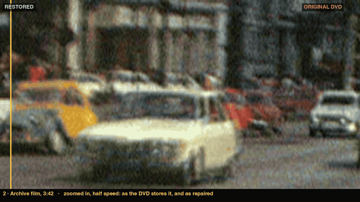

**Start with the showreel:** [`media/showreel.mp4`](media/showreel.mp4) (under a minute, with sound; the wipe above is cut from it). Each scene is shown full-frame side by side and zoomed in on the spot where the difference is largest, in slow motion where it helps; the archive-film repair gets a half-speed wipe reveal and a blink comparison of one frame, as the DVD stores it and as repaired. It ends with the German soundtrack's repaired ending, with sound.

The single clips, each with the original DVD's frames as stored on the left and the restoration on the right, at the restoration's 50 frames per second:

| Clip | What to look for |
|---|---|
| [`media/1_archive_tv_motion_74m31.mp4`](media/1_archive_tv_motion_74m31.mp4) | true interlaced video: a moving hand tears into stripes on the left and is a solid picture of each moment on the right |
| [`media/2_mispaired_film_repaired_3m42.mp4`](media/2_mispaired_film_repaired_3m42.mp4) | archive film the DVD stored with its halves mismatched: fences and cars shimmer on the left; on the right the original film frames are back, with no pixel invented |
| [`media/3_line_noise_cleaned_24m14.mp4`](media/3_line_noise_cleaned_24m14.mp4) | fine horizontal line noise baked into an old transfer, removed by the measured clean-up |
| [`media/4_german_ending_with_sound_87m05.mp4`](media/4_german_ending_with_sound_87m05.mp4) | the restored German track, with the original score carried through the end credits where the DVD's track fell silent |

## What is in this repository

```
paper/full/    the full technical report (PDF, two sizes)
paper/short/   the short report (PDF)
media/         the comparison clips above
figures/       key figures from the reports
scripts/       the analysis and build pipeline (VapourSynth + Python/NumPy); see TOOLCHAIN_NOTES.md
data/          the per-field decisions and calibration results the reports cite
```

Highlights of `scripts/`:

| File | What it does |
|---|---|
| `fielddiff_all.py`, `crossdiff_all.py`, `crossweave_blocks.py`, `localdiff_all.py`, `staticdiff_all.py`, `comb_blocks.py`, `cadence.py` | the whole-film interlace forensic passes |
| `fm_decide.py` (+ `fm_common.py`) | the per-field rule: joins a field with its same-instant partner when the evidence is clear, otherwise sends it to the deinterlacer |
| `qtgmc_value.py`, `qtgmc_choose.py` | renders the film twice and measures where a full rebuild removes transfer line noise without costing detail |
| `main_50p.vpy`, `extras_50p.vpy` | the 50 fps master pipeline: one method per output frame |
| `calib_x265.py` | 60 calibration encodes scored frame by frame with VMAF and SSIMULACRA2 |
| `encode_run.py`, `mux_final.py`, `post_verify.py` | chunked, resumable, frame-count-verified encoding; assembly; every-frame verification |
| `caption_timing.py`, `ocr_subs.py`, `text_audit.py` | subtitle OCR, the on-screen text audit, and frame-exact timing of translated titles |
| `build_intro_audio.py`, `motion_integrity.py` | bit-exact, frame-pinned intro audio; the field-order sweep of the finished film |
| `provenance_gallery.py`, `decision_barcode.py` | the line-by-line figures, the key and the film-wide pixel totals (the first renders the finished frames through the pipeline and checks every kept or lifted line bit-exact against the disc); the decision barcode |

`data/main_fieldmatch.npy` holds one decision per output frame (0 = deinterlacer, 1 = joined with the previous frame's field, 2 = own frame, 3 = next frame's field) together with the evidence that decided it; `data/main_qtgmc_choice.json` lists all 908 shots with their measured line-noise share and detail cost; `data/results.json` holds the 60 calibration encodes' scores.

## Reproducing

The pipeline runs on VapourSynth R81 with BestSource, vszip, MVTools and QTGMC (havsfunc r33), x265 4.3, ffmpeg, SoX, Tesseract and MKVToolNix. On Apple Silicon three QTGMC plugins must be compiled from source and two components re-pointed; `scripts/TOOLCHAIN_NOTES.md` records the exact steps and patches. The scripts expect the project folder at `~/Movies/ChampagneSpy_work` (change `W` at the top of each script).

## Work with me

I take on consulting work: video and audio restoration, archival digitisation, measured encoding pipelines, and AI-assisted engineering projects like this one, where a careful process matters more than a quick result. If you have a collection, a catalogue or a problem like this, message me on [GitHub](https://github.com/levihorsley) or [LinkedIn](https://www.linkedin.com/in/levihorsley).

## Licence

- Code (`scripts/`): [PolyForm Noncommercial License 1.0.0](LICENSE). Free for personal, research and other noncommercial use; commercial use requires a separate licence from the author.
- Reports, figures, data and clips: [CC BY-NC-ND 4.0](LICENSE-REPORT.md).

Chapter 17 of the full report measures the effort and estimates what the same job would have taken without AI assistance: 95 to 255 hours of hands-on work, with four of the key results likely missed.

## Scope and rights

The disc was purchased. It carries no copy protection, so nothing was circumvented, and the restored files exist for personal viewing only. This repository contains the method, the measurements, the code and short excerpts for comparison; it contains no copy of the film. Frames and clips from *The Champagne Spy* (2007, dir. Nadav Schirman; © its producers and Neue Visionen) appear only as small crops and brief excerpts for technical commentary. If you hold rights in the film and object to any excerpt, open an issue and it will be removed.
